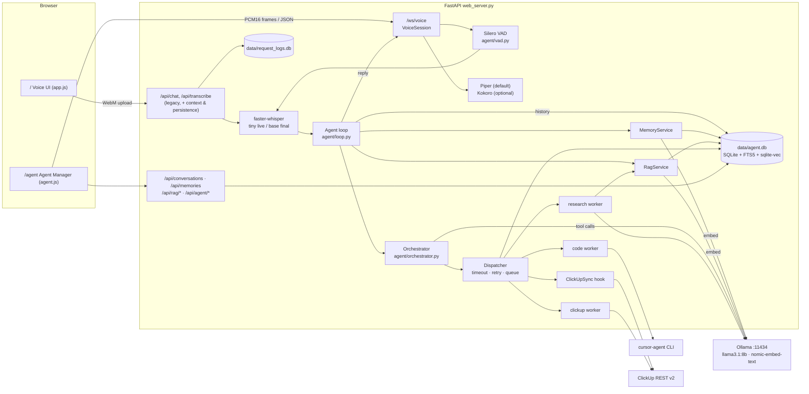

# Architecture

## Overview

Sahir is a **local-first voice agent**. Everything — speech, models, chat history,
long-term memory, document index, task log — runs and is stored on this PC (`data/` SQLite files).
The only optional network integration is ClickUp (REST v2, token in `.env`).

It is organised in four layers (ClickUp task *"Build local-first voice chat AI with task delegation"*):

| Layer | What | Code |
|-------|------|------|
| 1. Voice I/O | Streaming mic → server-side **Silero VAD** endpointing → faster-whisper → … → sentence-by-sentence **Piper/Kokoro** TTS, **barge-in** | `web/voice_ws.py`, `agent/vad.py`, `audio_pipeline.py`, `tts_backends.py` |
| 2. Orchestrator | Ollama (llama3.1:8b) with full conversation history + memory + RAG context decides: answer / PC tool / delegate; worker results injected back as tool messages; final reply composed from results | `agent/orchestrator.py`, `agent/loop.py` |
| 3. Delegation | Task `{id,type,description,context,priority,callback}` → Result `{task_id,status,output,errors,duration}`; direct-call or priority-queue transport; timeout + retry with backoff; result hooks/callbacks; every handoff persisted | `agent/delegation.py` |
| 4. Workers | `research` (RAG + Ollama summarizer), `code` (cursor-agent), `clickup` (create task / status / comment / time entry) + `ClickUpSync` hook mapping any worker output to ClickUp actions | `agent/workers.py`, `agent/clickup.py` |

## Turn lifecycle (voice)

1. Browser streams 16 kHz PCM16 over `/ws/voice` (echo-cancelled mic).
2. `Endpointer` runs Silero v5 on 32 ms frames: `speech_start` after 200 ms voiced, utterance after
   `VOICE_END_SILENCE_MS` (700 ms) silence. If the agent is busy/speaking, `speech_start` triggers
   **barge-in**: the generation counter increments, late LLM output is dropped, TTS stops, client stops playback.
3. Whisper (`WHISPER_FINAL_MODEL`) transcribes → `transcript` event.
4. `Agent.respond(mode="agent")`: load last `AGENT_HISTORY_TURNS` from SQLite, embed the query once,
   retrieve top memories + document chunks (sqlite-vec cosine), save the user message.
5. `Orchestrator.run`: Ollama tool call → `answer` | PC tool | one or more `delegate` calls.
   Producers run in parallel; result consumers (ClickUp) run after them with `previous_results`.
   Up to 3 rounds. Every task carries `history`, `memories`, `rag_sources`, `conversation_id`, `previous_results`.
6. Results are injected as `tool` messages; the final spoken reply is composed from them.
7. Assistant message saved with `action`, `sources`, `tasks`; background memory extraction
   proposes **pending** memories for review.
8. Reply split into sentences → TTS per sentence → `audio` header + binary WAV frames.

## Data (all local, gitignored)

| Path | Contents |
|------|----------|
| `data/agent.db` | `conversations`, `messages` (+ `messages_fts` FTS5), `memories` (active/pending/rejected + embedding), `documents`, `chunks` (+ embedding), `tasks` (delegation log) |
| `data/request_logs.db` | request log + voice commands (unchanged) |
| `data/logs/` | rotating logs, `e2e_agent_results.json` |
| `models/piper/`, `models/kokoro/` | TTS voices |

Embeddings are float32 BLOBs; when the sqlite-vec extension loads, search runs in SQL with
`vec_distance_cosine`, otherwise a numpy brute-force fallback is used (same results).

## Entry points

| Command | Mode |
|---------|------|
| `python bot.py --web` / `bash scripts/voice-assistant.sh start` | Web UI + agent + `/ws/voice` |
| `python bot.py` | Desktop: PTT + wake word + local mic (legacy router) |
| `python scripts/e2e_agent.py --base https://127.0.0.1:8766` | Milestone E2E checks |
| `venv/bin/python -m pytest` | Offline unit/API tests |

## Core modules

| Path | Role |
|------|------|
| `config.py` | Voice/web settings (`.env`) incl. `TTS_BACKEND`, `VAD_*`, `AGENT_PERSIST_WEB` |
| `agent/config.py` | Agent settings (`AGENT_DB_PATH`, `EMBED_MODEL`, `RAG_*`, `MEMORY_*`, `AGENT_*`) |
| `agent/factory.py` | Builds store, embedder, LLM, workers, dispatcher, ClickUp hook, orchestrator |
| `agent/store.py` | SQLite schema + queries |
| `agent/memory.py`, `agent/rag.py` | Memory extraction/review, document ingest/chunk/retrieve |
| `agent/loop.py` | Agent loop (modes `agent`/`route`/`chat`/`cursor`, SSE streaming) |
| `agent/orchestrator.py`, `agent/delegation.py`, `agent/workers.py`, `agent/clickup.py` | Layers 2–4 |
| `web/agent_api.py`, `web/voice_ws.py` | REST + WebSocket for the agent |
| `web/static/agent.*` | Agent Manager UI |
| `tools/router.py` | Legacy single-shot router (now accepts a context block) |
| `web_server.py` | FastAPI app; legacy routes gain Silero VAD gate, memory/RAG context, persistence |

## External dependencies

| Service | Config | Notes |
|---------|--------|-------|
| Ollama | `OLLAMA_HOST`, `OLLAMA_MODEL`, `EMBED_MODEL` | `llama3.1:8b`, `nomic-embed-text` |
| Piper / Kokoro | `PIPER_*`, `TTS_BACKEND`, `KOKORO_*` | Kokoro via `scripts/setup_kokoro.sh` |
| Whisper | `WHISPER_*` | HF cache |
| cursor-agent | `CURSOR_*` | code worker |
| ClickUp | `CLICKUP_API_TOKEN`, `CLICKUP_LIST_ID` (required), `CLICKUP_TEAM_ID` | optional |
| ffmpeg, TLS | system / `WEB_SSL_*` | WebM decode, LAN mic |

See [upgrade-research.md](./upgrade-research.md) for the technology survey and roadmap.
